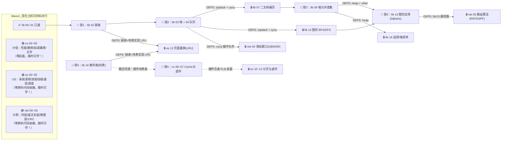

# 408 全局通关路线图（真实依赖解锁 + 四科并行交叉版）

> **一句话总纲**：全套四门课（66 关 + 16 个刷题节点）统一采用 **「🟢 先学会模式 · 两段式闯关法」 + 「四科并行批次（Wave 1~4）交叉学习」**——
> 1. **平时闯关（只学基础，3 步速通）**：① 用 1 组简单数字看懂物理画面 → ② 敲入 10~15 行最简核心代码跑通 `_test` → ③ 用自己的话做 **1 次总反讲** + 记概念卡片，直接标 **`✅ 基础已通`** 过关！（**一轮日常跳过所有 🎯 代码算法大题与跨关综合大题**）
> 2. **四门课怎么交叉并行**：全仓库只有 **6 把硬依赖锁**（见下方依赖图）。我们将 66 关划分为 **4 个并行批次（Wave 1 ~ Wave 4）**：**在同一个批次内部，四门课没有任何互相阻塞，你可以每天或隔天在 `lib / co / os / net` 之间自由换脑子交叉推进**！
> 3. **到了 `🎯 板块刷题节点`（每 3~6 关一次，共 16 个）**：停下不写新代码，集中用真题选择题和手推状态表“验货”。

---

## 📊 全局总进度看板

- **第一批 Wave 1（当前可四门随时并行开局！）**：`2 / 21` 关已完成（`lib 00`、`lib 01` ✅）
  - 🟢 数据结构 `lib`：`2 / 7` 关（下一步 👉 `lib/02 链表`）
  - 🟡 计组 `co`：`0 / 5` 关（随时可开 👉 `co/00 性能指标`）
  - 🔵 操作系统 `os`：`0 / 4` 关（随时可开 👉 `os/00 系统调用`）
  - 🟣 计网 `net`：`0 / 4` 关（随时可开 👉 `net/00 时延计算器`）
- **第二批 Wave 2（等 Wave 1 造出栈/队列后解锁）**：`0 / 21` 关
- **第三批 Wave 3（等 Wave 2 造出堆/散列表/Cache 后解锁）**：`0 / 12` 关
- **第四批 Wave 4（四科收官 + 排序/哈希保底通杀 🎯 代码大题）**：`0 / 13` 关
- **🔴 Boss MiniMachine**：一个整机工程 `boss/00-minimachine`，`0 / 14` 个阶段（Wave 3 末解锁阶段 00~07，Wave 4 末解锁阶段 08~13；首个 👉 boss 阶段 00 isa-asm）
- **总计**：**`2 / 66` 关（3.0%）** · 已完成刷题节点 **`0 / 16`**

---

## 🔑 全仓库真实的「6 把硬依赖锁」（哪些必须先学，哪些可以并行）

> 下面这张图直接根据全仓库所有关卡的 `DEPS` 代码依赖文件和 408 概念前置关系生成。**除了箭头标出的先后关系外，其余科目和关卡全部可以随时并行交叉学习！**

| 锁编号 | 必须先学完（钥匙 🔑） | 才能解锁去学（被锁住的关卡 🔒） | 为什么有这个依赖？（真实 `DEPS` + 考纲联动） |
|---|---|---|---|
| **🔑 锁 1** | **`lib/03 栈` + `lib/04 队列`** | • `net/04 滑动窗口（停等/GBN/SR）` • `lib/07 二叉树遍历` • `lib/12 图的存储与遍历` | 计网 `net/04` 的发送窗口在 `DEPS` 中直接复用了 `lib/04` 的循环队列 `cycq.c`；树和图的非递归 DFS/BFS 直接复用了 `lib/03` 的栈和 `lib/04` 的队列 |
| **🔑 锁 2** | **`lib/02 链表` + `lib/16 散列表`** | • `os/12 页面置换与工作集（LRU）` | OS 的 `os/12` 在 `DEPS` 中直接依赖了 `lib/02-linked-list` 和 `lib/16-hash` 来组合实现 LRU 置换 |
| **🔑 锁 3** | **`lib/09 堆、哈夫曼树、并查集`** | • `lib/13 图的应用（Kruskal）` • `lib/18 选择、归并与基数排序` | `lib/13` 的 Kruskal 最小生成树直接复用 `lib/09` 的小根堆挑边、用并查集判环；`lib/18` 的堆排序直接复用 `lib/09` 的堆 |
| **🔑 锁 4** | **`lib/12~13 图的遍历与最短路`** | • `net/09 路由算法与 SDN` | 计网 `net/09` 在 `DEPS` 中直接依赖了 `lib/13-graph-app`（OSPF 链路状态路由底层就是 Dijkstra 算法） |
| **🔑 锁 5** | **各科目内部的连号依赖** | • `co/02 加法器` → `co/03 乘除`（依赖 `word.c`） • `co/06 Cache` → `co/07 虚存地址翻译` • `os/06 互斥` → `os/07 PV 经典问题`（依赖 `sem.c`） • `net/00 时延` → `net/04~06, 14`（依赖 `qty.c`） • `net/01 封装` → `net/10`；`net/13` → `net/14` | 同科目内后一关直接复用了前一关写好的底层小组件，按本科目序号顺着学即可自然满足 |
| **🔑 锁 6** | **`lib/16 散列表` + `lib/17~18 排序`** | • `lib 01 / 02 / 07` 的 **🎯 41 题代码算法大题** | 学完哈希数组和快速排序/归并排序后，回头写 408 的代码大题才能直接用「先排序」或「空间换时间」的直白保底高分法降维秒杀 |

---

## 🚀 第一批（Wave 1）：四科并行开局 · 打造线性底座（20 关 + 2 节点）

> **并行规则**：下面四列 **现在全部都已解锁**！你可以主推 `lib` 造出链表/栈/队列，累了随时切去 `co / os / net` 的第 00 关换脑子。
> **本批核心产出**：造出 **`链表 + 栈 + 队列`**（`lib 02~04`）和 **`计网单位库`**（`net 00`），为第二批解锁大门。

### 🟢 `lib` 线（线性结构 · 剩 5 关 + 1 节点）
- [x] **`lib/00` · C 热身与测试工具**（`✅ 已通过`）
- [x] **`lib/01` · 顺序表 🎯**（`✅ 基础已通 · L3`）—— 动态数组增删查 + `2013-41 主元素`
- [ ] 👉 **`lib/02` · 链表 🎯**（🔑 **造钥匙：解锁 `os/12`**）—— 头插/尾插建表、单链表插删查、双链表与循环链表、静态链表（跳过末尾 🎯 大题）
- [ ] **`lib/03` · 栈**（🔑 **造钥匙：解锁 `lib 07/12`**）—— 顺序栈、链栈、共享栈（`top1 + 1 == top2`）、括号匹配与后缀表达式手推
- [ ] **`lib/04` · 队列**（🔑 **造钥匙：解锁 `net 04`、`lib 07/12`**）—— 循环队列（牺牲一格 vs `size` vs `tag`）、链队列、双端队列输出序列
- [ ] **`lib/05` · 多维数组与特殊矩阵** —— 行/列优先地址公式、对称/三角/三对角矩阵下标映射
- [ ] **`lib/06` · 串与 KMP** —— 朴素匹配、手推 `next` 与 `nextval` 数组、KMP 比较次数
- [ ] 🎯 **【节点 1 · `lib` 线性结构刷题日】** —— 集中手推 408 线性表、栈出入栈序列、循环队列判满、矩阵地址、KMP `next` 数组选择题

### 🟡 `co` 线（数据表示与运算 · 5 关 + 1 节点，随时可并行！）
- [ ] 👉 **`co/00` · 性能指标与程序的执行过程** —— 主频、CPI、MIPS、CPU 执行时间公式手推（纯算式，换脑子首选）
- [ ] **`co/01` · 数的编码、对齐与大小端** —— 原码/反码/补码/移码转换、边界对齐与大小端字节序
- [ ] **`co/02` · 加法器与定点加减**（🔑 解锁 `co/03`）—— 补码加减法器、标志位 `ZF / SF / CF(无符号溢出) / OF(有符号溢出)`
- [ ] **`co/03` · 定点乘除**（依赖 `co/02`）—— 移位乘除原理、C 语言 `int` 与 `unsigned` 混合运算陷阱
- [ ] **`co/04` · IEEE 754 浮点数** —— 1 位符号 + 8 位阶码(偏置 127) + 23 位隐含 1 尾数、规格化与浮点加减对阶
- [ ] 🎯 **【节点 2 · `co` 数据表示与运算刷题日】** —— 集中刷 CPI、补码标志位 `CF/OF`、IEEE 754 十六进制互转历年真题

### 🔵 `os` 线（内核入门与进程概念 · 4 关，随时可并行！）
- [ ] 👉 **`os/00` · 运行环境与系统调用** —— 内核态/用户态切换、特权指令、中断与系统调用
- [ ] **`os/01` · OS 结构、引导与虚拟机** —— 宏内核 vs 微内核、开机引导流程、第一/二类虚拟机
- [ ] **`os/02` · 进程与线程** —— PCB、进程五状态转换图、内核级线程 vs 用户级线程
- [ ] **`os/03` · 进程间通信** —— 共享存储、消息传递、管道与信号

### 🟣 `net` 线（网络体系、物理层与差错控制 · 4 关，随时可并行！）
- [ ] 👉 **`net/00` · 时延与性能计算器**（🔑 **造钥匙：解锁 `net 04~06, 14`**）—— 发送时延($L/R$) + 传播时延($d/v$)、时延带宽积（极简公式关，换脑子首选）
- [ ] **`net/01` · 分层封装与报文解析**（🔑 解锁 `net/10`）—— OSI 七层 vs TCP/IP 五层、各层 PDU 与首部字节解析
- [ ] **`net/02` · 物理层：信道容量与编码** —— 奈氏准则与香农公式、曼彻斯特编码、电路/报文/分组交换时延
- [ ] **`net/03` · 组帧与差错控制** —— 零比特填充（5 个 1 插 0）、CRC 循环冗余校验模 2 除法、海明码校验位

---

## ⚙️ 第二批（Wave 2）：树与散列 × Cache 存储 × 进程调度同步 × 链路与 IP（21 关 + 5 节点）

> **准入条件**：只要第一批里的 **`lib 03 栈 + 04 队列`** 和 **`net 00 时延`** 通了，下面四列即可全面并行推进！
> **跨科联动爽点**：在 `lib 16` 学完**散列表（哈希）**，去学计组 `co 06` 的 **Cache 映射**，你会发现硬件 Cache 其实就是用硬件做了一个散列表！

### 🟢 `lib` 线（树与查找篇 · 8 关 + 1 节点，需先通 `lib 03~04`）
- [ ] **`lib/07` · 二叉树与遍历 🎯**（依赖 `lib 03~04`）—— 二叉树性质计算（$n_0 = n_2 + 1$）、先/中/后/层序遍历、由遍历序列建树（跳过末尾 🎯 大题）
- [ ] **`lib/08` · 线索二叉树、树与森林** —— 中序线索化找前驱后继、双亲/孩子/孩子兄弟表示法、树与森林转二叉树
- [ ] **`lib/09` · 堆、哈夫曼树、并查集**（🔑 **造钥匙：解锁 `lib 13`、`lib 18`**）—— 手推建堆与增删、哈夫曼树 WPL、并查集合并与判环
- [ ] **`lib/10` · 二叉搜索树与 AVL** —— BST 插删查、AVL 四种旋转（LL/RR/LR/RL）与最少结点数递推
- [ ] **`lib/11` · 红黑树** —— 红黑树 5 条性质口诀、黑高计算、AVL vs 红黑树卡片
- [ ] 🎯 **【节点 3 · `lib` 树与平衡树刷题日】** —— 集中手推二叉树性质、遍历建树、哈夫曼 WPL、堆调整、AVL/红黑树与并查集真题
- [ ] **`lib/14` · 顺序、折半与分块查找** —— 折半查找判定树、成功与失败 ASL 计算
- [ ] **`lib/15` · B 树与 B+ 树** —— $m$ 阶 B 树分裂/合并、关键字个数上下限、B 树 vs B+ 树卡片
- [ ] **`lib/16` · 散列表**（🔑 **造钥匙：解锁 `os/12` 及阶段四算法大题**）—— 除留余数法、开放定址与拉链法、成功/失败 ASL 计算

### 🟡 `co` 线（存储系统篇 · 3 关 + 1 节点，与 `lib 16 散列表` 强联动）
- [ ] **`co/05` · 半导体存储器、主存与磁盘** —— SRAM vs DRAM 刷新、主存字位扩展与片选线、多体交叉存储
- [ ] **`co/06` · Cache 模拟器**（🔑 解锁 `co/07`）—— 直接映射/全相联/组相联地址划分（标记|组号|块内偏移）、总容量计算、LRU 与写策略
- [ ] **`co/07` · 虚拟存储与地址翻译**（依赖 `co/06`，🔑 **造钥匙：联动 `os 10~12`**）—— 页表 + TLB 快表 + Cache 全链路地址查找与命中组合
- [ ] 🎯 **【节点 4 · `co` 存储系统刷题日】** —— 集中手推 408 必考的「Cache 地址位数与总容量」「TLB + 页表 + Cache 三合一综合大题」

### 🔵 `os` 线（处理机调度 + 同步互斥死锁 · 5 关 + 2 节点）
- [ ] **`os/04` · CPU 调度算法** —— 手推 FCFS、SJF/SRTF、RR、HRRN 的周转时间与带权周转时间
- [ ] **`os/05` · 多级反馈队列与上下文切换** —— 多级反馈队列抢占规则、模式切换 vs 进程上下文切换
- [ ] 🎯 **【节点 5 · `os` 进程与调度刷题日】** —— 集中刷用户态/内核态事件、进程状态转换、调度甘特图与周转时间真题
- [ ] **`os/06` · 互斥的实现**（🔑 解锁 `os/07`）—— 同步四原则、Peterson 算法、关中断与硬件原子指令 `TSL/Swap`
- [ ] **`os/07` · PV 经典问题**（依赖 `os/06`）—— 信号量 `P/V` 物理含义、生产者-消费者 / 读写者 / 哲学家进餐 / 前驱图套路
- [ ] **`os/08` · 死锁与银行家算法** —— 死锁四个必要条件、手推银行家算法安全序列与资源分配图化简
- [ ] 🎯 **【节点 6 · `os` 同步与死锁刷题日】** —— 集中刷 408 必考的 **PV 操作大题** 与银行家算法真题

### 🟣 `net` 线（可靠传输、局域网与 IP 编址转发 · 5 关 + 2 节点，需先通 `lib/04` 与 `net/00`）
- [ ] **`net/04` · 可靠传输：停等、GBN、SR**（🔒 **硬依赖 `lib/04 队列` + `net/00`**）—— 滑动窗口尺寸上限（GBN $\le 2^n-1$，SR 发+收 $\le 2^n$）、信道利用率
- [ ] **`net/05` · 介质访问控制**（依赖 `net/00`）—— 信道划分（CDM 码片正交内积）、CSMA/CD 最短帧长 $2\tau \times R$ vs CSMA/CA
- [ ] **`net/06` · 局域网与交换机**（依赖 `net/00`）—— 以太网 MAC 帧、VLAN、交换机自学习转发表与冲突域/广播域
- [ ] 🎯 **【节点 7 · `net` 物理与链路层刷题日】** —— 集中刷奈氏香农、滑动窗口利用率、CDM 码片、CSMA/CD 与交换机转发表真题
- [ ] **`net/07` · IPv4 编址与分片** —— 子网掩码与 CIDR、路由聚合（最长前缀匹配）、IP 分片（片偏移以 8B 为单位）
- [ ] **`net/08` · 分组转发、NAT、ARP 与 IPv6** —— 跨网段转发（IP 不变、MAC 逐跳变）、ARP 广播请求单播响应、DHCP、NAT 表
- [ ] 🎯 **【节点 8 · `net` IP 编址与组网大题刷题日】** —— 集中刷 408 必考的 **「网络层综合组网大题」**

---

## 🖥️ 第三批（Wave 3）：图论 × CPU 流水线 × OS 虚拟内存 × 路由协议（12 关 + 4 节点）

> **准入条件与跨科联动**：
> 1. 只要第二批的 **`lib/09 堆与并查集`** 通了，立刻先通 **`lib 12~13 图论`** → 直接解锁计网 **`net 09~10 路由算法`**（计网 OSPF 直接复用 `lib/13` 的 Dijkstra！）。
> 2. 只要 **`lib/02 链表 + lib/16 散列表 + co/07 虚存地址翻译`** 通了，直接平推 **`os 09~12 内存管理与页面置换`**（硬件页表与 OS 缺页置换无缝合体！）。

### 🟢 `lib` 线（图论篇 · 2 关 + 1 节点，需先通 `lib 03~04` 与 `lib 09`）
- [ ] **`lib/12` · 图的存储与遍历**（🔒 **硬依赖 `lib 03 栈 + 04 队列`**）—— 邻接矩阵/邻接表、BFS 与 DFS、连通分量与度数性质
- [ ] **`lib/13` · 图的应用**（🔒 **硬依赖 `lib 09 堆与并查集`**，🔑 **造钥匙：解锁 `net/09`**）—— 手推 Prim/Kruskal 最小生成树、Dijkstra/Floyd 最短路表、拓扑排序与关键路径
- [ ] 🎯 **【节点 9 · `lib` 图论刷题日】** —— 集中手推邻接表遍历序列、最小生成树、Dijkstra 表格、拓扑与关键路径真题

### 🟣 `net` 线（路由算法与协议 · 2 关 + 1 节点，需先通 `lib/13` 与 `net/01`）
- [ ] **`net/09` · 路由算法与 SDN**（🔒 **硬依赖 `lib/13 图的应用`**）—— 距离向量（慢收敛与 16 跳不可达） vs 链路状态（Dijkstra）、SDN 流表
- [ ] **`net/10` · 路由协议、组播与移动 IP**（🔒 **硬依赖 `net/01 报文封装`**）—— RIP(UDP) vs OSPF(IP) vs BGP(TCP)、IPv4 组播转 MAC（低 23 位映射）
- [ ] 🎯 **【节点 10 · `net` 路由协议刷题日】** —— 集中刷 RIP 距离向量路由表更新、OSPF/BGP 对比与组播 MAC 真题

### 🟡 `co` 线（指令系统与 CPU 流水线 · 4 关 + 1 节点，可随时并行）
- [ ] **`co/08` · 指令系统与 x86 汇编** —— 寻址方式（相对寻址 $EA = (PC) + A$）、x86 汇编与函数调用栈帧
- [ ] **`co/09` · 迷你 CPU 与数据通路** —— 单周期/多周期数据通路、取指与执行阶段微操作控制信号
- [ ] **`co/10` · 控制器、异常与中断** —— 硬布线 vs 微程序控制器、故障(Fault)/自陷(Trap)/终止(Abort)与外部中断
- [ ] **`co/11` · 指令流水线** —— 五段流水线时空图、结构冒险 / 数据冒险（转发 vs 阻塞） / 控制冒险
- [ ] 🎯 **【节点 11 · `co` 指令与 CPU 刷题日】** —— 集中刷寻址方式、数据通路寄存器传值、x86 机器码与流水线冒险大题

### 🔵 `os` 线（内存管理与虚存置换 · 4 关 + 1 节点，需先通 `lib/02`、`lib/16` 与 `co/07`）
- [ ] **`os/09` · 内存管理基础与连续分配** —— 动态分区分配（FF / BF / WF）与内外部碎片、伙伴系统
- [ ] **`os/10` · 分页、分段与地址翻译**（联动 `co/07`）—— 单级/多级页表页号切分（顶级页表不超 1 页）、快表 TLB 与 EAT
- [ ] **`os/11` · 请求分页与内存映射文件** —— 页表项标志位、缺页中断处理流程、`mmap`
- [ ] **`os/12` · 页面置换与工作集**（🔒 **硬依赖 `lib/02 链表 + lib/16 散列表`**）—— 手推 OPT、FIFO、LRU、CLOCK 缺页置换表与工作集
- [ ] 🎯 **【节点 12 · `os` 内存管理刷题日】** —— 集中手推多级页表虚拟地址拆分、页面置换缺页次数表综合大题

### 🔴 `boss` 阶段解锁点（Wave 3 末 · 8 个阶段）
> boss 是一个整机工程 `boss/00-minimachine`，分 14 个阶段往上长：某个阶段的前置关卡全部学完就可以开，流程和普通关卡一样；阶段按序号串行，后一个还要等前一个完成（尝试里的 `.stage` 记学到第几阶段）。阶段 03、05 的前置关卡在 Wave 2 就已学完，但要排在阶段 00~02 之后。详情见 [boss/LEVELS.md](boss/LEVELS.md)。
- [ ] **boss 阶段 00 · isa-asm** —— 前置 `co 01~04、08、09`：MM32 指令集、汇编器、多周期节拍 trace
- [ ] **boss 阶段 01 · interrupt** —— 前置 `co 10`、`os 00`：异常、中断、`syscall`，用户态与内核态切换
- [ ] **boss 阶段 02 · pipeline** —— 前置 `co 00、11`：五段流水线、冒险检测与转发、CPI/MIPS 统计
- [ ] **boss 阶段 03 · memory** —— 前置 `co 05、06`：多体交叉主存、Cache
- [ ] **boss 阶段 04 · mmu** —— 前置 `co 07`、`os 10`：TLB 加两级页表，页故障进内核
- [ ] **boss 阶段 05 · process** —— 前置 `os 02~05`、`lib 04、09`：PCB、fork/exec、可切换调度算法
- [ ] **boss 阶段 06 · sync** —— 前置 `os 06~08`、`lib 12`：信号量系统调用、经典 PV、银行家、死锁检测
- [ ] **boss 阶段 07 · vm** —— 前置 `os 09、11、12`、`lib 02、16`：请求分页、置换算法、工作集、伙伴系统

---

## 🏆 第四批（Wave 4）：四科同步收官 + 排序/哈希保底通杀 🎯 代码算法大题（13 关 + 4 节点）

> **并行规则**：下面四门课的收官板块互不阻塞，可以任意顺序并行扫尾；最后在 **【节点 16】** 拿着「排序 + 散列表」两大降维武器，把前面跳过的 🎯 41 题代码算法大题一次性保底通杀！

### 🟡 `co` 收官（多处理器、总线与 I/O · 2 关 + 1 节点）
- [ ] **`co/12` · 多处理器与并行** —— SISD/SIMD/MIMD、硬件多线程、Cache 一致性
- [ ] **`co/13` · 总线与 I/O 方式** —— 总线带宽、程序查询 vs 中断（指令结束响应） vs DMA（存取周期结束响应）
- [ ] 🎯 **【节点 13 · `co` 总线与 I/O 刷题日】** —— 集中刷中断屏蔽字与响应优先级、DMA 占用 CPU 时间百分比真题（🎉 **计组全科通关！**）

### 🔵 `os` 收官（文件系统与 I/O 磁盘 · 4 关 + 1 节点）
- [ ] **`os/13` · 文件与目录** —— FCB 与 inode、硬链接（共享 inode 计数） vs 软链接（存路径）、两级打开文件表
- [ ] **`os/14` · 文件系统的实现** —— FAT 显式链接、**混合索引分配（直接块 + 一/二/三级间接块求最大文件大小）**、位示图
- [ ] **`os/15` · I/O 管理** —— I/O 软件层次、单缓冲 vs 双缓冲耗时计算、SPOOLing
- [ ] **`os/16` · 磁盘与固态硬盘** —— 磁盘读写时间、手推 FCFS / SSTF / SCAN / LOOK / C-SCAN 磁头移动道数
- [ ] 🎯 **【节点 14 · `os` 文件与磁盘刷题日】** —— 集中刷混合索引 inode 最大文件计算、FAT 表、单双缓冲与磁盘调度真题（🎉 **操作系统全科通关！**）

### 🟣 `net` 收官（传输层与应用层 · 4 关 + 1 节点）
- [ ] **`net/11` · UDP 与 TCP 连接管理** —— 端口号、UDP 伪首部、TCP 三次握手与四次挥手（序号 `seq`、确认号 `ack`、2MSL）
- [ ] **`net/12` · TCP 可靠传输、流量与拥塞控制** —— 接收窗口 `rwnd`、**拥塞控制四算法（慢开始 → 拥塞避免；超时 `ssthresh` 减半、`cwnd=1`；3 个重复 ACK 快恢复 `cwnd=ssthresh`）**
- [ ] **`net/13` · Socket、HTTP 与 DNS**（🔑 解锁 `net/14`）—— DNS 递归 vs 迭代查询、HTTP 1.0/1.1 持续与非持续连接 RTT 计算
- [ ] **`net/14` · 电子邮件、FTP 与 P2P**（🔒 **硬依赖 `net/00 + net/13`**）—— FTP 控制(21)/数据(20)连接、SMTP(推) vs POP3(拉)、P2P 分发时间
- [ ] 🎯 **【节点 15 · `net` 传输与应用层刷题日】** —— 集中刷 TCP 序号确认号、拥塞控制 `cwnd` 折线图、HTTP + DNS 总 RTT 大题（🎉 **计算机网络全科通关！**）

### 🟢 `lib` 收官（内外部排序 + 🎯 41 题代码大题保底通杀 · 3 关 + 1 节点）
- [ ] **`lib/17` · 插入与交换排序** —— 手推每一趟：直接插入、折半插入、希尔、冒泡、**快速排序（重点：每趟 Pivot 划分到位）**
- [ ] **`lib/18` · 选择、归并与基数排序**（🔒 **硬依赖 `lib/09 堆`**）—— 简单选择、堆排序、二路归并、基数排序；汇总**「时空复杂度 + 稳定性 + 趟数特征」终极卡片**
- [ ] **`lib/19` · 外部排序** —— 多路归并趟数 $\lceil \log_k r \rceil$、败者树、置换-选择生成初始归并段、最佳归并树（哈夫曼补虚段）
- [ ] 🎯 **【节点 16 · `lib` 排序刷题 + 🎯 41 题代码大题总收官】**：
  1. **排序与外排选择题验收**：由中间序列反推排序方法、败者树与最佳归并树计算；
  2. **拿着「排序 + 散列表（哈希数组）」两大武器，回头用直白保底高分法（稳拿 70%~80% 分）统一扫平 🎯 代码算法大题**：
     - [ ] `lib/01 顺序表`：2011-42 两个升序序列中位数（直白双指针合并数到第 $n$ 个 `O(n)`）、2018-41 未出现的最小正整数（开哈希标记数组秒杀）
     - [ ] `lib/02 链表`：链表原地逆置、2009-42 找倒数第 $k$ 个结点（双指针）、2012-42 两链表公共后缀起点（先求表长差对齐）、2015-41 按绝对值去重（开哈希标记数组）、2019-41 链表首尾重排
     - [ ] `lib/07 二叉树`：2014-41 求带权路径长度 WPL（先序递归累加 `weight * depth`）、2017-41 表达式树转中缀加括号（中序递归）、2022-41 顺序存储二叉树判断是否为二叉搜索树
  （🎉 **数据结构与 408 全科一轮大满贯！**）

### 🔴 `boss` 阶段解锁点（Wave 4 末 · 6 个阶段）
> 接着 Wave 3 末的阶段 07 往下做。阶段 10、11 的前置关卡在 Wave 2、Wave 3 就已学完，但要排在阶段 09 之后。考点落点见 [boss/COVERAGE.md](boss/COVERAGE.md)。
- [ ] **boss 阶段 08 · fs-disk** —— 前置 `os 13、14、16`、`lib 15`：inode 与 FAT、目录、磁盘调度、SSD 损耗均衡
- [ ] **boss 阶段 09 · io** —— 前置 `co 13`、`os 15`：总线、DMA、中断驱动 I/O、缓冲、SPOOLing
- [ ] **boss 阶段 10 · link** —— 前置 `net 00~06`、`lib 04`：模拟线路（真实 UDP 只做演示）、成帧加 CRC、滑动窗口、交换机节点
- [ ] **boss 阶段 11 · ip** —— 前置 `net 07~10`、`lib 13`：IP 分片、ARP、NAT、路由器节点、RIP/OSPF，BGP 选开
- [ ] **boss 阶段 12 · transport-app** —— 前置 `net 11~14`：TCP、DNS、HTTP、SMTP
- [ ] **boss 阶段 13 · showcase** —— 前置四门全部关卡：shell 工具集、综合大题场景脚本、两台机器开机互发 HTTP 的演示（🎉 **MiniMachine 完工！**）
