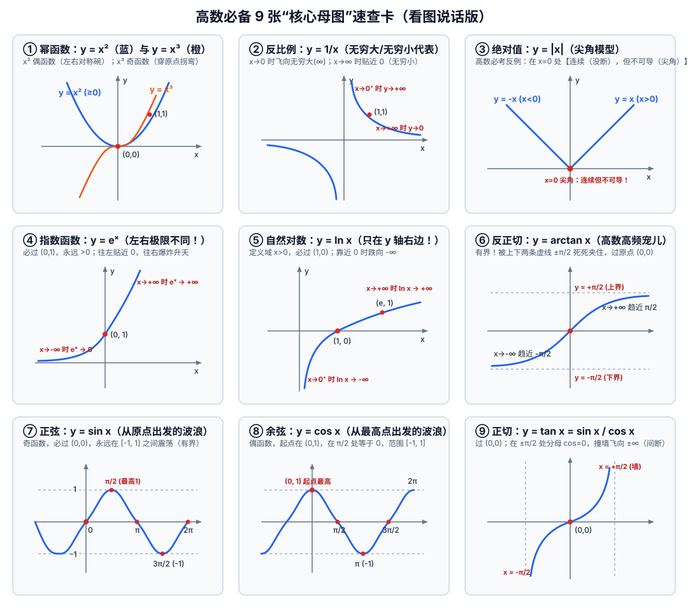

# 考研高数·零基础案头速查手抄报（打印版）

> **使用方法**：**不要背这份表格！** 把它打印出来（或分屏放手边）。直接去看高数第一章，题里遇到哪个符号、哪张图不认识，低头花 10 秒钟查一下，看懂当前那一步就继续往下学。

---

## 一、 高数必备 9 张“核心母图”（看图说话区）

### 怎么用上面的图一眼看出高数概念？

| 高数黑话（概念） | 看图怎么判断（人话翻译） | 结合上面 9 张图举例 |
| :--- | :--- | :--- |
| **极限** $\lim$ | 当 $x$ 往某个位置凑近时，曲线的高度 $y$ **往哪个数字贴近**？ | 看图④ $y=e^x$：$x$ 往左走到底（$x \to -\infty$）时，高度贴近 **$0$**；往右走（$x \to +\infty$）时，高度飞向 **$+\infty$**。 |
| **有界** | 整条曲线能不能被**上下两条水平横线**夹在中间，不出界？ | 图⑥ $\arctan x$（夹在 $\pm\frac{\pi}{2}$ 之间）、图⑦ $\sin x$ 和图⑧ $\cos x$（夹在 $\pm 1$ 之间）都是**有界函数**。 |
| **连续** | 画这条线的时候，**笔尖有没有离开纸面（有没有断开）**？ | 图⑨ $\tan x$ 在 $x = \pm\frac{\pi}{2}$ 处撞墙断开了，叫**间断点**；图② $\frac{1}{x}$ 在 $x=0$ 处也断开了。 |
| **可导（光滑）** | 曲线不仅没断开，而且拐弯处**圆润光滑、没有扎手的“尖角”**。 | 图③ $y=\|x\|$ 在原点 $(0,0)$ 虽然没断（连续），但是个 V 字**尖角**，所以在 $x=0$ 处**不可导**！ |
| **奇函数 / 偶函数** | **偶函数**：左右对称（沿着 $y$ 轴对折完全重合）； **奇函数**：绕原点旋转 $180^\circ$ 重合（必过原点或成对对称）。 | **偶函数**：$x^2$、$\|x\|$、$\cos x$； **奇函数**：$x^3$、$\frac{1}{x}$、$\sin x$、$\tan x$、$\arctan x$。 *(注：$e^x$ 和 $\ln x$ 既不是奇函数也不是偶函数)* |

---

## 二、 指数 $e^x$ 与对数 $\ln x$ 速查卡（互为死对头）

### 1. 到底什么是 $e$ 和 $\ln x$？
- **$e$ 是个固定常数**：就像 $\pi \approx 3.14$ 一样，自然常数 **$e \approx 2.718$**（记住它比 $2$ 大、比 $3$ 小就够了）。
- **$\ln x$ 就是以 $e$ 为底的对数**：即 $\ln x = \log_e x$。
  - **人话翻译**：看到 **$\ln \square$**，就是在问你：**“$e$ 的几次方等于 $\square$？”**
  - 因为 $e^0 = 1$，所以 **$\ln 1 = 0$**（高频必考！）；
  - 因为 $e^1 = e$，所以 **$\ln e = 1$**（高频必考！）；
  - 因为 $e$ 和 $\ln$ 是互逆操作，凑在一起直接抵消：**$e^{\ln x} = x$**，**$\ln(e^x) = x$**。

### 2. 幂与对数的 6 条救命变形律（高数化简全靠它）

| 指数（幂）运算律 | 对数 $\ln$ 运算律（把乘除降级为加减） | 考研避坑提醒 |
| :--- | :--- | :--- |
| $a^0 = 1 \quad (a \neq 0)$ | **$\ln 1 = 0$**，$\quad \ln e = 1$ | $\ln 0$ **不存在**（趋于 $-\infty$），负数不能放进 $\ln$ 里！ |
| $a^{-n} = \frac{1}{a^n}$（负号变倒数，如 $x^{-1}=\frac{1}{x}$） | **$\ln(A \cdot B) = \ln A + \ln B$**（里面相乘 = 外面相加） | ❌ 千万别写成 $\ln(A+B) = \ln A + \ln B$（加号拆不开！） |
| $a^{\frac{1}{2}} = \sqrt{a}$，$\quad a^{\frac{m}{n}} = \sqrt[n]{a^m}$ | **$\ln\left(\frac{A}{B}\right) = \ln A - \ln B$**（里面相除 = 外面相减） | 看到 $\ln\frac{1}{x}$，直接变成 $\ln 1 - \ln x = -\ln x$ |
| $a^m \cdot a^n = a^{m+n}$，$\quad (a^m)^n = a^{mn}$ | **$\ln(A^k) = k \cdot \ln A$**（头顶的次方可以直接揪到前面当乘数！） | 例：$\ln(x^3) = 3\ln x$；$\ln\sqrt{x} = \ln(x^{\frac{1}{2}}) = \frac{1}{2}\ln x$ |

---

## 三、 三角与反三角函数速查卡

### 1. 角度换算与 5 个特殊角数值表（规律记忆法）
> **高数里一律用 $\pi$ 表示角度**：记住 **$\pi = 180^\circ$**，往里除就行（$\frac{\pi}{2}=90^\circ$，$\frac{\pi}{3}=60^\circ$，$\frac{\pi}{4}=45^\circ$，$\frac{\pi}{6}=30^\circ$）。

| 角度（度数） | $0^\circ$ | $30^\circ$ | $45^\circ$ | $60^\circ$ | $90^\circ$ | $180^\circ$ | **秒记规律** |
| :--- | :---: | :---: | :---: | :---: | :---: | :---: | :--- |
| **高数写法（弧度）** | **$0$** | **$\frac{\pi}{6}$** | **$\frac{\pi}{4}$** | **$\frac{\pi}{3}$** | **$\frac{\pi}{2}$** | **$\pi$** | 分母是 $6, 4, 3, 2$ |
| **$\sin x$（正弦）** | $0$ | $\frac{1}{2}$ | $\frac{\sqrt{2}}{2}$ | $\frac{\sqrt{3}}{2}$ | $1$ | $0$ | 分子是 $\sqrt{0}, \sqrt{1}, \sqrt{2}, \sqrt{3}, \sqrt{4}$ 除以 $2$，从小到大 |
| **$\cos x$（余弦）** | $1$ | $\frac{\sqrt{3}}{2}$ | $\frac{\sqrt{2}}{2}$ | $\frac{1}{2}$ | $0$ | $-1$ | 把 $\sin x$ 的顺序**倒过来写**！ |
| **$\tan x = \frac{\sin x}{\cos x}$** | $0$ | $\frac{\sqrt{3}}{3}$ | **$1$** | $\sqrt{3}$ | 不存在($\infty$) | $0$ | 上下两行直接相除，最常考 $\tan\frac{\pi}{4}=1$ |
| **$\arctan$ 反查** | $\arctan 0 = 0$ | $\arctan\frac{\sqrt{3}}{3}=\frac{\pi}{6}$ | **$\arctan 1 = \frac{\pi}{4}$** | $\arctan\sqrt{3}=\frac{\pi}{3}$ | **$\arctan(+\infty)=\frac{\pi}{2}$** | — | 问 $\arctan 1$ 等于几，就是反查“谁的 $\tan$ 等于 $1$” |

### 2. 高数真题出场率最高的 5 条三角公式（其余生僻公式先不管）
1. **平方和恒等于 1（第一高频）**：
   $$\sin^2 x + \cos^2 x = 1 \quad \Longrightarrow \quad 1 - \cos^2 x = \sin^2 x, \quad 1 - \sin^2 x = \cos^2 x$$
2. **正切与正割平方关系（求导/积分常客）**：
   $$1 + \tan^2 x = \sec^2 x = \frac{1}{\cos^2 x} \quad \text{（注：}\sec x = \frac{1}{\cos x}\text{，叫正割）}$$
3. **二倍角正弦（把两个拆成一个，或把一个拆开）**：
   $$\sin(2x) = 2\sin x \cos x$$
4. **二倍角余弦与降幂公式（求极限、求积分必用！）**：
   $$\cos(2x) = \cos^2 x - \sin^2 x = 1 - 2\sin^2 x = 2\cos^2 x - 1$$
   $$\Longrightarrow \text{半角替换（求极限神技）：}\quad 1 - \cos x = 2\sin^2\left(\frac{x}{2}\right)$$
5. **反三角恒等式（小题常考）**：
   $$\arctan x + \operatorname{arccot} x = \frac{\pi}{2}, \qquad \arcsin x + \arccos x = \frac{\pi}{2}$$

---

## 四、 代数变形与因式分解速查卡（求极限约分专用）

高数第一章求极限时，经常遇到 $\frac{0}{0}$ 型（分子分母代进去都等于 $0$），这时候只要用下面 4 个公式把分子分母拆开、约掉害它变成 $0$ 的那一项，答案瞬间就出来了：

1. **平方差公式（出镜率 100%，还经常用来给根号有理化）**：
   $$a^2 - b^2 = (a - b)(a + b)$$
   - **根号变形技巧**：看到 $\sqrt{A} - \sqrt{B}$ 算不出来，上下同乘 $(\sqrt{A} + \sqrt{B})$，分子立刻变成 $A - B$，根号就消掉了！
2. **完全平方公式**：
   $$(a \pm b)^2 = a^2 \pm 2ab + b^2$$
3. **立方差 / 立方和公式（考研特爱考 $x^3 - 1$）**：
   $$a^3 - b^3 = (a - b)(a^2 + ab + b^2) \quad \Longrightarrow \quad x^3 - 1 = (x - 1)(x^2 + x + 1)$$
   $$a^3 + b^3 = (a + b)(a^2 - ab + b^2) \quad \Longrightarrow \quad x^3 + 1 = (x + 1)(x^2 - x + 1)$$
4. **一元二次方程 $ax^2 + bx + c = 0$ 求根与十字相乘**：
   - 求根公式：$x_{1,2} = \frac{-b \pm \sqrt{b^2 - 4ac}}{2a}$
   - 找到两个根 $x_1, x_2$ 后，直接写成因式分解：$ax^2 + bx + c = a(x - x_1)(x - x_2)$
   - *例：$x^2 - 3x + 2 = (x - 1)(x - 2)$*
